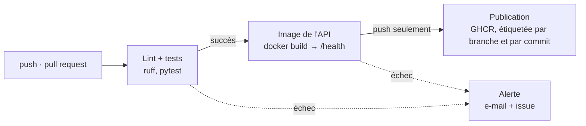

# Agritech Answers — Système de recommandation de cultures

[](https://github.com/to-haladjian/OC_projet_DS_12/actions/workflows/ci.yml)

Application web qui aide un agriculteur à (1) estimer le rendement d'une culture dans ses
conditions et (2) obtenir le classement des cultures les plus productives pour ces mêmes
conditions. **Un seul modèle répond aux deux questions** : les deux écrans affichent donc le
même rendement pour la même culture.

**Streamlit** (interface) → **FastAPI** (API, modèle) → **MLflow** (suivi des
expérimentations) → **GitHub Actions** (tests, image, publication).

Le rapport destiné à un lecteur non technique est dans
[`reports/rapport_metier.pdf`](reports/rapport_metier.pdf).

## Démarrage rapide

```bash
make install      # environnement virtuel et dépendances
make all          # données -> modèles -> lint -> tests
make api          # API sur http://127.0.0.1:8000/docs
make app          # interface sur http://localhost:8501 (API démarrée)
```

`make help` liste toutes les cibles. Les données brutes ne sont pas versionnées ; elles
doivent être placées dans :

```
data/raw/Agriculture Crop Yield/crop_yield.csv
data/raw/Crop Yield Prediction Dataset/{yield,temp,rainfall,pesticides}.csv
data/raw/FAOSTAT Prices/Prices_E_All_Data_(Normalized).zip
```

La troisième source ne fait pas partie des données fournies : elle sert uniquement à la
lecture économique du classement. Elle est gratuite et se télécharge directement :

```bash
mkdir -p "data/raw/FAOSTAT Prices" && curl -o "data/raw/FAOSTAT Prices/Prices_E_All_Data_(Normalized).zip" \
  "https://bulks-faostat.fao.org/production/Prices_E_All_Data_(Normalized).zip"
```

Sans les données brutes, le dépôt reste utilisable : les modèles, leurs fichiers de service
et le dataset consolidé sont versionnés, donc `make test`, `make api` et `make app`
fonctionnent sur un clone neuf.

## Rejouer le projet

Chaque phase est une cible `make` ; les agrégats les enchaînent dans l'ordre.

| Cible | Ce qu'elle fait |
|---|---|
| `make data-fao` | reconstruit le jeu FAO depuis ses quatre sources brutes |
| `make data-consolidated` | construit le dataset consolidé (parcelles simulées + profils FAO) |
| `make data-prices` | nettoie les prix au producteur FAOSTAT |
| **`make data`** | les trois, dans l'ordre |
| `make train-practice` | entraîne le modèle des pratiques (parcelles simulées) |
| `make train-yield` | entraîne le modèle de rendement servi par l'API (données FAO) |
| `make assets` | écrit les fichiers JSON que l'API sert à côté du modèle |
| **`make train`** | les trois, dans l'ordre ; chaque entraînement est journalisé dans MLflow |
| `make select-yield` | compare les familles de modèles candidates, sous les deux protocoles |
| `make compare` | affiche tous les runs sur les métriques communes, écrit `reports/model_comparison.csv` |
| `make mlflow-ui` | ouvre le journal d'expérimentations sur http://127.0.0.1:5000 |
| `make notebooks` | ré-exécute les dix notebooks (long) |
| `make check-notebooks` | vérifie que chaque notebook compile, a été exécuté, sans erreur |
| `make lint` / `make test` | `ruff` / `pytest` |
| `make report` | génère `reports/rapport_metier.pdf` |
| `make api` / `make app` / `make up` | l'API, l'interface, ou les deux en conteneurs |
| **`make all`** | `data` → `train` → `lint` → `test` |

## Données

Deux jeux fournis, de natures opposées :

| | Agriculture CropYield | CropYield Prediction |
|---|---|---|
| Nature | 1 000 000 de parcelles **simulées** | données **réelles** FAO / Banque mondiale |
| Granularité | parcelle, sans pays ni année | pays × année × culture, 1990-2013 |
| Ce qu'il apporte | l'effet de l'engrais et de l'irrigation | l'écart entre cultures |
| Ce qui lui manque | la culture n'y a **aucun effet** sur le rendement | aucune pratique agricole |

Six notebooks, un par question, à parcourir dans l'ordre :

| # | Notebook | Objet |
|---|---|---|
| 01 | [`01_eda_agriculture_crop_yield`](notebooks/01_eda_agriculture_crop_yield.ipynb) | EDA du jeu simulé — aucun nettoyage appliqué |
| 02 | [`02_pca_agriculture_crop_yield`](notebooks/02_pca_agriculture_crop_yield.ipynb) | ACP, avec puis sans la cible |
| 03 | [`03_eda_crop_yield_prediction`](notebooks/03_eda_crop_yield_prediction.ipynb) | EDA des 4 sources brutes + audit de `yield_df.csv` |
| 04 | [`04_build_crop_yield_dataset`](notebooks/04_build_crop_yield_dataset.ipynb) | Reconstruction du jeu historique (appariement ISO3) |
| 05 | [`05_dataset_consolidation_strategy`](notebooks/05_dataset_consolidation_strategy.ipynb) | Confrontation des deux jeux, proxies, stratégie de fusion |
| 06 | [`06_build_consolidated_dataset`](notebooks/06_build_consolidated_dataset.ipynb) | Nettoyage, fusion et export |

L'analyse exploratoire **constate** ; elle ne tranche pas. Chaque notebook d'EDA se termine
par ses décisions différées, appliquées seulement aux notebooks 04 et 06.

**Ce que les données ont établi :**

1. **Dans le jeu simulé, la culture n'influence pas le rendement** : toutes à ≈ 4,65 t/ha,
   à 0,03 t/ha près, y compris à conditions comparables. Les données FAO montrent à
   l'inverse un écart de 12,8× entre cultures. Aucun classement de cultures ne peut donc
   venir du jeu simulé.
2. **Le fichier pré-fusionné fourni est inexploitable.** `yield_df.csv` ne garde que les
   101 pays dont le nom s'écrit de la même façon dans les quatre sources — il perd les
   États-Unis, la Chine, la Russie, la Turquie, le Viêt Nam — et plus de la moitié de ses
   lignes sont des doublons, dus à un fan-out de `temp.csv` (jusqu'à 41 relevés par
   pays-année). Le jeu est reconstruit depuis ses sources, par code ISO3, chaque jointure
   étant contrôlée : **117 pays** complets, aucune clé dupliquée.
3. **Les variables clés du jeu simulé ne se retrouvent qu'en partie dans les données
   réelles.** La pluie, dominante dans le simulé (ρ = 0,77), n'est pas liée au rendement
   entre pays FAO ; seuls les intrants vont dans le même sens. L'ACP du jeu simulé est
   plate (≈ 20 % de variance par axe) : ses variables sont indépendantes, il n'y a rien à
   réduire.
4. **Proxies.** Les pesticides tiennent lieu d'intensité en intrants (donc de
   fertilisation) ; une pluie annuelle sous 300 mm signale une agriculture irriguée.

Le **dataset consolidé** (999 769 × 18, `data/processed/crop_dataset_consolidated.csv.gz`)
joint à chaque parcelle simulée le profil FAO de sa culture. Ses colonnes d'enrichissement
ne servent à aucun modèle — la corrélation entre le rendement de référence FAO et le
rendement simulé est de −0,0007 : la fusion a servi d'**analyse**, et c'est elle qui a fixé
l'architecture. Colonnes : [`reports/data_dictionary.md`](reports/data_dictionary.md).

## Modélisation

| Modèle | Données | Rôle |
|---|---|---|
| **Modèle de rendement** — `ExtraTreesRegressor` | FAO reconstruit | sert `/predict` et `/recommend` |
| **Effet des pratiques** — `LinearRegression` | parcelles simulées | fournit l'effet de l'engrais (+1,50 t/ha) et de l'irrigation (+1,20 t/ha), affiché à part |

| # | Notebook | Objet |
|---|---|---|
| 07 | [`07_practice_effects_model`](notebooks/07_practice_effects_model.ipynb) | Effet des pratiques — structure résiduelle, comparaison, ablation |
| 08 | [`08_practice_effects_tuning`](notebooks/08_practice_effects_tuning.ipynb) | Effet des pratiques — recherche d'hyperparamètres et modèle final |
| 09 | [`09_yield_model`](notebooks/09_yield_model.ipynb) | Modèle de rendement — protocole, variables, familles, recherche |
| 10 | [`10_ranking_and_final_model`](notebooks/10_ranking_and_final_model.ipynb) | Modèle de rendement — classement servi, taille, évaluation finale |

**Ce que la modélisation a établi :**

1. **Une évaluation naïve aurait menti.** Le rendement d'un pays pour une culture est
   corrélé à 0,985 avec l'année précédente : un découpage aléatoire place des lignes quasi
   identiques des deux côtés. L'évaluation est **chronologique** — apprendre sur le passé,
   prédire l'année suivante — et 2013 n'a servi à aucun choix.
2. **La famille servie est choisie sur une comparaison appariée.** Cinq familles sur les
   mêmes plis : `ExtraTrees` l'emporte sur les cinq années (RMSE 1,45 t/ha, contre 1,61
   pour la forêt aléatoire et 1,87 pour le gradient boosting). La recherche
   d'hyperparamètres (36 candidats) ne trouve aucun gain qui tienne d'une année à l'autre.
3. **Ce que le modèle sait d'un pays inconnu est mesuré.** En validation « hors pays »
   (chaque pays prédit par un modèle qui ne l'a jamais vu), la RMSE passe de 1,45 à
   **4,06 t/ha** (R² 0,72). L'essentiel de la précision vient de l'historique du pays ; les
   conditions saisies ajustent l'estimation, elles ne la fondent pas.
4. **Un classement en tonnes brutes répondait « pomme de terre » partout** : l'écart avec
   les céréales est surtout de l'eau. Le classement est rendu aussi en **matière sèche**,
   et limité aux quatre cultures du produit présentes dans les données FAO (maïs, blé, riz,
   soja). Sur ces quatre cultures, la meilleure est en tête dans 92 % des cas.
5. **La rentabilité est approchée par le produit brut** (rendement × prix au producteur
   FAOSTAT). Ce n'est pas une marge : les coûts sont inconnus. Pour un pays sur deux, ±20 %
   de prix suffit à changer la première culture : les prix sont donc modifiables.
6. **Le jeu simulé n'avait rien à optimiser.** Un boosting entraîné sur le résidu d'une
   régression linéaire à 4 variables n'en prédit rien (R² ≈ 0) : il ne reste que du bruit.
   27 candidats sur trois familles, aucun ne bat la régression linéaire.

### Suivi des expérimentations

Tous les runs sont journalisés dans MLflow (base SQLite locale) **sur un schéma unique**,
ce qui les rend comparables entre modèles :

- la même **description** : `model_family`, `dataset`, `feature_set`, `protocol`, `phase`,
  `seed` ;
- les mêmes **métriques** : `cv_rmse_mean/std`, `cv_mae_mean/std`, `cv_r2_mean/std`,
  `fit_seconds`, et pour un modèle final `test_rmse`, `test_mae`, `test_r2` ;
- une métrique **sans unité**, `cv_nrmse_mean` / `test_nrmse` (RMSE ÷ rendement moyen) :
  la RMSE en t/ha ne se compare qu'à l'intérieur d'un jeu, celle-ci se compare entre les deux.

Un run incomplet est refusé à l'enregistrement. Chaque candidat d'une recherche est un run
imbriqué, avec les métriques complètes. Deux expériences : `agritech-yield-engine` et
`agritech-practice-effects`. `make compare` en tire un tableau unique.

## API

Une API **FastAPI** sert le modèle. Elle ne lit que `models/` et jamais `data/`.
Documentation interactive : `/docs`.

| Endpoint | Rôle |
|---|---|
| `GET /health` | état, modèle chargé, versions de scikit-learn (service et entraînement) |
| `GET /countries` | les 117 pays servis |
| `GET /countries/{iso3}` | conditions et prix de référence du pays (préremplissage) |
| `GET /predict/context` | cultures disponibles, cultures indisponibles et leur motif, bornes |
| `POST /predict` | pays + culture + conditions facultatives → rendement et intervalle à 95 % |
| `POST /recommend` | pays + conditions et prix facultatifs → les 4 cultures classées |

```bash
curl -X POST localhost:8000/predict -H 'content-type: application/json' \
  -d '{"iso3": "FRA", "crop": "Wheat", "temperature_c": 13.5}'
curl -X POST localhost:8000/recommend -H 'content-type: application/json' \
  -d '{"iso3": "FRA", "temperature_c": 13.5, "price_usd_t": {"Wheat": 260}, "criterion": "gross_product"}'
```

**Choix de conception**

- **Une seule estimation pour les deux endpoints.** Les deux prennent les mêmes conditions,
  les résolvent de la même façon et interrogent le même modèle : `/predict` renvoie la ligne
  de la culture demandée, `/recommend` les quatre, triées. Un test vérifie qu'ils donnent le
  même chiffre.
- **Le pays est obligatoire, le reste facultatif.** Le modèle a besoin de la position et de
  l'historique d'un pays : l'utilisateur choisit son pays, et peut remplacer la température,
  la pluie, les pesticides et les prix par les siens. Les champs remplacés sont rappelés
  dans la réponse (`entered_values`).
- **Un intervalle mesuré.** L'intervalle à 95 % de `/predict` vient de l'erreur relative
  observée en validation chronologique, culture par culture ; il couvre 94 à 98 % des cas
  sur l'année de test.
- **Engrais et irrigation à part.** Leur effet vient des parcelles simulées : il est renvoyé
  dans `practice_effects`, à titre indicatif, et n'est jamais additionné à l'estimation.
- **Orge et coton refusés, avec le motif** : absents des données FAO, ils ne peuvent être ni
  estimés ni classés honnêtement.
- **Impossible → refusé, inhabituel → signalé.** Une pluie négative est refusée (422) ; une
  température rare pour la culture est estimée avec un avertissement. Un pays non servi
  renvoie 404.
- **Noms de champs en anglais, messages en français.** Le code est en anglais ; tout ce que
  lit l'utilisateur est en français.

```bash
docker build -t agritech-api .
docker run -p 8000:8000 agritech-api     # le port se règle avec -e PORT=...
```

L'image (`python:3.13-slim`) n'embarque que `src/`, `api/` et `models/`, tourne sous un
utilisateur non-root et déclare un `HEALTHCHECK` sur `/health`. Les dépendances sont
épinglées dans [`api/requirements.txt`](api/requirements.txt) : le modèle est un pickle,
scikit-learn doit rester en 1.9.0 — l'API compare les deux versions au démarrage.

## Interface

Une interface **Streamlit** (`app/`) propose **Prédiction** et **Recommandation**. Elle ne
contient **aucune logique ML** : elle construit ses formulaires à partir de ce que l'API
décrit, envoie la saisie et affiche la réponse. Tous ses appels passent par
[`app/api_client.py`](app/api_client.py).

Les deux écrans commencent de la même façon : le pays, puis ses conditions **préremplies**
et modifiables.

- **Prédiction** : la culture → un **chiffre** (t/ha), son intervalle, l'équivalent en
  matière sèche, l'effet indicatif de l'engrais et de l'irrigation, et les avertissements.
- **Recommandation** : le critère de tri (rendement par défaut, matière sèche ou produit
  brut) et les prix → un **graphique à barres** trié, un **tableau** détaillé, les cultures
  non classées et les avertissements.

Seules les valeurs modifiées partent vers l'API. Une culture jamais pratiquée dans le pays
est atténuée dans le graphique **et** signalée dans son étiquette. Les nombres sont au
format français. Si l'API est absente ou en démarrage, l'interface affiche un message clair.

`API_URL` règle l'adresse de l'API (par défaut `http://localhost:8000` ; dans Compose,
`http://api:8000`).

## Tests, intégration continue et déploiement

`make test` joue 112 tests : contrat HTTP, accord entre `/predict` et `/recommend`,
interface de bout en bout, préparation des données, découpages sans fuite, schéma de suivi
MLflow, et un petit réentraînement des deux modèles sur données générées.

Le workflow [`.github/workflows/ci.yml`](.github/workflows/ci.yml) s'exécute à chaque push
sur `dev` ou `main`, sur chaque pull request, et à la demande.



| Job | Rôle | Condition |
|---|---|---|
| `tests` | `ruff check`, puis toute la suite | push, pull request, ou manuellement |
| `image` | construit l'image de l'API, vérifie qu'elle répond, **la publie sur GHCR** | si `tests` passe ; publication sur push seulement |
| `alerte` | ouvre ou commente une issue portant le lien du run | si un job échoue sur un push |

- **Aucun secret dans le projet.** La publication s'authentifie avec le `GITHUB_TOKEN` que
  GitHub fournit à chaque run.
- **Les contrôles critiques échouent bien.** `image` dépend de `tests` ; avant de publier, le
  job démarre le conteneur et interroge `/health` — une image qui ne charge pas son modèle
  s'arrête là, registre intact.
- **Les données brutes ne sont pas dans la CI** : les tests qui lisent le jeu FAO reconstruit
  s'ignorent d'eux-mêmes, tout le reste tourne sur des données générées.
- **Notifications** : GitHub envoie un e-mail à l'auteur du push ; le job `alerte` y ajoute
  une issue étiquetée `ci`, une seule ouverte à la fois.

```bash
docker pull ghcr.io/to-haladjian/oc_projet_ds_12:dev
docker run -p 8000:8000 ghcr.io/to-haladjian/oc_projet_ds_12:dev
```

GHCR est un **registre** : il entrepose l'image, aucun conteneur n'y tourne.

### L'interface en ligne, sur Streamlit Community Cloud

Streamlit Cloud exécute **un seul processus Python** et n'expose **qu'un port** : il ne peut
pas héberger l'API à côté de l'interface, et aucun hébergeur gratuit n'accepte un conteneur
de cette taille (les Spaces Docker de Hugging Face exigent désormais un abonnement à la
création).

La réponse n'est pas de réimplémenter le modèle dans l'interface. Avec `API_EMBEDDED=1`,
[`app/embedded_api.py`](app/embedded_api.py) démarre `api.main:app` dans un thread, sur un
port de la boucle locale, et `api_client` l'interroge **en HTTP comme toujours** : même
application, mêmes validations, mêmes codes de statut. Seul le saut réseau devient local.

| | `API_URL` | `API_EMBEDDED` | L'API tourne |
|---|---|---|---|
| Streamlit Cloud | — | `1` | dans le processus de l'interface |
| `docker compose up` | `http://api:8000` | — | dans le conteneur voisin |
| Développement local | — | — | là où vous l'avez lancée (`localhost:8000`) |

Sur [share.streamlit.io](https://share.streamlit.io), *Create app* → *Deploy a public app
from GitHub* :

| Champ | Valeur |
|---|---|
| Repository | `to-haladjian/OC_projet_DS_12` |
| Branch | `dev` |
| Main file path | **`streamlit_app.py`** (à la racine, pas `app/app.py`) |
| *Advanced* → Python version | **3.13** |
| *Advanced* → Secrets | `API_EMBEDDED = "1"` |

Le point d'entrée est à la racine parce que Community Cloud lit le fichier de dépendances
du dossier du point d'entrée avant celui de la racine : avec `app/app.py`, il n'installerait
que Streamlit et l'API embarquée échouerait à l'import. Il préfère aussi un `uv.lock` à un
`requirements.txt` : ce fichier n'est donc pas versionné, et un test le surveille. La version
de Python ne se change plus après le déploiement : 3.13, celle du modèle sérialisé.

## Structure

```
data/raw/          jeux de données sources (non versionnés)
data/processed/    datasets produits (seul le dataset consolidé compressé est versionné)
notebooks/         les dix notebooks d'analyse et de modélisation
reports/           rapport métier, comparaison des modèles, dictionnaire de données, figures
models/            modèles, métadonnées et fichiers de service de l'API
api/               API FastAPI et ses dépendances
app/               interface Streamlit, son client HTTP et son Dockerfile
tests/             tests des données, des modèles, de l'API et de l'interface
scripts/           vérification des notebooks, génération du rapport
Makefile           toutes les commandes du projet
streamlit_app.py   point d'entrée pour Streamlit Cloud (exécute app/app.py)
requirements.txt   dépendances à la racine, pour Streamlit Cloud (renvoie vers api/ et app/)
Dockerfile         image de l'API
docker-compose.yml API + interface en local
.github/workflows/ pipeline CI/CD
src/
  config.py        chemins, graine aléatoire, année de test
  utils.py         style des figures, profilage, mesures d'interaction
  tracking.py      suivi MLflow sur un schéma unique, tableau de comparaison
  data/
    geo.py                     noms de pays -> ISO3 et coordonnées (tables figées)
    crop_mapping.py            harmonisation des cultures + règles d'imputation
    preparation.py             lecture et nettoyage du jeu simulé
    crop_yield_prediction.py   reconstruction du jeu historique
    build_dataset.py           profils par culture, fusion, export
    prep_log.py                journal des décisions de préparation
    prices.py                  prix au producteur FAOSTAT
  models/
    features.py                jeux de variables + table de matière sèche
    protocol.py                découpages aléatoire, temporel et hors pays
    evaluation.py              métriques, comparaison appariée, qualité du classement
    history.py                 variables retardées et géographie, sans fuite
    tuning.py                  recherche d'hyperparamètres, chaque candidat journalisé
    selection.py               comparaison des familles de modèles
    practice_model.py          effet des pratiques + test de structure résiduelle
    yield_model.py             modèle de rendement servi + logique de classement
    serving_assets.py          fichiers de service de l'API (contextes, prix, domaine)
```

Deux modules sont des **références uniques**, à ne pas dupliquer : `crop_mapping.py` pour
le vocabulaire des cultures et `geo.py` pour les pays. La table d'appariement des noms de
pays vers leur code ISO3 est **figée dans le dépôt** : générée une fois avec `pycountry`,
puis relue et complétée à la main. Les huit noms laissés sans code sont des entités
historiques disparues (URSS, Tchécoslovaquie, Yougoslavie…) : un choix documenté.
