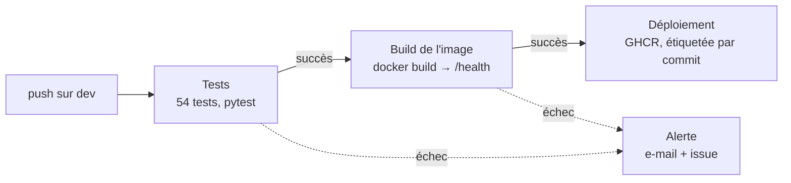

# Agritech Answers — Système de recommandation de cultures

[](https://github.com/to-haladjian/OC_projet_DS_12/actions/workflows/ci.yml)

Projet OpenClassrooms : application web permettant à un agriculteur (1) d'estimer le
rendement d'une culture selon les conditions de sa parcelle et (2) d'obtenir un classement
des cultures les plus productives pour ces mêmes conditions.

Architecture cible : **Streamlit** (front) → **FastAPI** (back, modèle ML) → **MLflow**
(suivi des expérimentations) → **GitHub Actions** (CI/CD).

## Avancement

| Étape | Objet | Statut |
|---|---|---|
| 1 | Exploration, fusion et préparation des données | ✅ terminée |
| 2 | Moteurs de prédiction et de recommandation + MLflow | ✅ terminée |
| 3 | API FastAPI + Docker | ✅ terminée |
| 4 | Interface Streamlit | ✅ terminée |
| 5 | Tests, CI/CD et déploiement | ✅ terminée |

## Installation

```bash
uv venv
uv pip install -e ".[notebook]"
```

Les données brutes ne sont pas versionnées (voir `.gitignore`). Elles doivent être placées
dans :

```
data/raw/Agriculture Crop Yield/crop_yield.csv
data/raw/Crop Yield Prediction Dataset/{yield,temp,rainfall,pesticides}.csv
data/raw/FAOSTAT Prices/Prices_E_All_Data_(Normalized).zip
```

La troisième source, hors sujet, sert uniquement à la lecture économique du classement
(étape 2). Elle est gratuite et se télécharge directement :

```bash
mkdir -p "data/raw/FAOSTAT Prices" && curl -o "data/raw/FAOSTAT Prices/Prices_E_All_Data_(Normalized).zip" \
  "https://bulks-faostat.fao.org/production/Prices_E_All_Data_(Normalized).zip"
```

## Étape 1 — Données

Six notebooks, un par question, à parcourir dans l'ordre :

| # | Notebook | Objet |
|---|---|---|
| 01 | [`01_eda_agriculture_crop_yield`](notebooks/01_eda_agriculture_crop_yield.ipynb) | EDA du jeu simulé — aucun nettoyage appliqué |
| 02 | [`02_pca_agriculture_crop_yield`](notebooks/02_pca_agriculture_crop_yield.ipynb) | ACP, avec puis sans la cible |
| 03 | [`03_eda_crop_yield_prediction`](notebooks/03_eda_crop_yield_prediction.ipynb) | EDA des 4 sources brutes + audit de `yield_df.csv` |
| 04 | [`04_build_crop_yield_dataset`](notebooks/04_build_crop_yield_dataset.ipynb) | Reconstruction du jeu historique (appariement ISO3) |
| 05 | [`05_dataset_consolidation_strategy`](notebooks/05_dataset_consolidation_strategy.ipynb) | Confrontation des deux jeux, validation des variables clés sur données réelles, proxies, stratégie |
| 06 | [`06_build_consolidated_dataset`](notebooks/06_build_consolidated_dataset.ipynb) | Nettoyage, fusion et export |

L'analyse exploratoire **constate** ; elle ne tranche pas. Chaque notebook d'EDA se termine
par ses décisions différées, appliquées seulement aux notebooks 04 et 06.

### Rejouer l'étape

```bash
# les deux datasets, en ligne de commande
.venv/bin/python -m src.data.crop_yield_prediction   # jeu historique reconstruit
.venv/bin/python -m src.data.build_dataset           # dataset consolidé

# ou l'analyse complète
cd notebooks && for nb in 0*.ipynb; do
  ../.venv/bin/python -m jupyter nbconvert --execute --to notebook --inplace "$nb"
done
```

Les scripts et les notebooks produisent des sorties **identiques au bit près**.

### Vérifier les notebooks

```bash
.venv/bin/python scripts/verifie_notebooks.py
```

Contrôle que chaque notebook compile, **qu'il a réellement été exécuté**, et qu'aucune
cellule n'a produit d'erreur. Le contrôle intermédiaire n'est pas superflu : un notebook dont
l'exécution a échoué n'a aucune sortie, donc aucune erreur — ne compter que les erreurs le
déclarerait sain à tort.

### Livrables

| Livrable | Fichier |
|---|---|
| Notebooks d'analyse et de fusion | [`notebooks/`](notebooks/) |
| Dataset consolidé (999 769 × 18) | `data/processed/crop_dataset_consolidated.csv.gz` — 43 Mo, versionné ; le CSV en clair (174 Mo) se régénère en local |
| Jeu historique reconstruit (25 527 × 8) | `data/processed/crop_yield_prediction.csv` |
| Bornes du domaine d'apprentissage (40 bornes) | `data/processed/domaine_apprentissage.csv` |
| Prix au producteur FAOSTAT nettoyés (étape 2) | `data/processed/prix_producteur.csv` |
| Synthèse métier | [`reports/etape1_synthese_fusion.md`](reports/etape1_synthese_fusion.md) |
| Dictionnaire des données | [`reports/data_dictionary.md`](reports/data_dictionary.md) |
| Figures | `reports/figures/` |

### Les quatre résultats structurants de l'étape 1

**1. Sans fusion, la recommandation n'a aucun sens.** Dans le jeu *Agriculture CropYield*,
la culture n'influence pas le rendement : toutes à ≈ 4,65 t/ha, soit un rapport de 1,00.
Et pas seulement en moyenne — à pluviométrie comparable l'écart maximum est de 0,028 t/ha,
l'effet de l'engrais ne varie que de 0,02 t/ha d'une culture à l'autre, et aucun plan
factoriel ne les sépare. Les données FAO montrent à l'inverse un écart de **12,8×**. La
fusion est donc ce qui rend la fonction de recommandation envisageable.

**2. Le fichier pré-fusionné fourni est inexploitable.** `yield_df.csv` ne contient que
101 pays — l'intersection littérale des noms de pays entre les quatre sources — et écarte
ainsi les **États-Unis, la Chine, la Russie, l'Iran, le Viêt Nam, la Corée du Sud, la
Tanzanie, la Tchéquie et la Turquie**. De plus, 54 % de son contenu est redondant, du fait
d'un fan-out de `temp.csv` (jusqu'à 41 relevés par pays-année). Le jeu est donc reconstruit
depuis ses sources brutes avec appariement ISO3 : **120 pays** et aucun doublon.

**3. L'enrichissement ne prédit pas la cible.** La corrélation entre le rendement de
référence FAO et le rendement simulé est de **−0,0007**. `/recommend` aura donc son propre
modèle, appris sur les données FAO. Conséquence assumée : les colonnes d'enrichissement du
dataset consolidé ne servent à aucun des deux modèles ; la fusion a servi d'**analyse**, et
c'est elle qui a fixé l'architecture. Détails dans le
[notebook 05](notebooks/05_dataset_consolidation_strategy.ipynb).

**4. Les variables clés du jeu simulé ne se retrouvent qu'en partie dans les données
réelles.** La pluie, dominante dans le simulé (ρ = 0,77), n'est pas liée au rendement entre
pays FAO (−0,06) ; la température y change de signe (−0,32) ; seuls les intrants
(pesticides, proxy de la fertilisation) vont dans le même sens (+0,46), et seulement d'un pays
à l'autre. La pluie FAO ne mesure pas l'eau reçue : sous 300 mm/an, les rendements ne
baissent pas, signe d'irrigation (proxy retenu). La hiérarchie des leviers est donc une
propriété du jeu simulé.

## Étape 2 — Modélisation

Deux services, deux jeux de données, deux modèles. Le jeu simulé ne distingue pas les
cultures : il ne peut donc pas les classer, et `/recommend` s'appuie sur les données FAO
reconstruites à l'étape 1.

| # | Notebook | Objet |
|---|---|---|
| 07 | [`07_modelisation_predict`](notebooks/07_modelisation_predict.ipynb) | `/predict` — test de structure résiduelle, comparaison, ablation des variables |
| 08 | [`08_optimisation_predict`](notebooks/08_optimisation_predict.ipynb) | `/predict` — campagne d'optimisation et modèle final |
| 09 | [`09_modelisation_recommend`](notebooks/09_modelisation_recommend.ipynb) | `/recommend` — protocole temporel, variables construites, modèles |
| 10 | [`10_classement_et_modele_final`](notebooks/10_classement_et_modele_final.ipynb) | `/recommend` — classement servi, taille du modèle, évaluation finale |

```bash
uv pip install mlflow
.venv/bin/python -m src.data.prix                 # prix au producteur FAOSTAT nettoyés
.venv/bin/python -m src.models.predict_model      # entraîne et sauvegarde /predict
.venv/bin/python -m src.models.recommend_model    # entraîne et sauvegarde /recommend
mlflow ui --backend-store-uri sqlite:///mlflow.db # consulter les 88 runs
```

### Les cinq résultats structurants de l'étape 2

**1. `/predict` n'avait rien à optimiser, et on sait pourquoi.** Un gradient boosting
entraîné à prédire le résidu d'une régression linéaire à 4 variables, à partir de **toutes**
les variables (16), obtient un R² hors échantillon **nul** (−0,0003) : il ne reste que du
bruit gaussien (σ = 0,499 t/ha), et R² = 0,913 est le maximum atteignable. (Le « plafond »
`1 − σ²/Var(y)` n'est pas une preuve : calculé sur le résidu linéaire, il égale le R² linéaire
par construction.) Les coefficients reconstituent le générateur du jeu :
`0,005·pluie + 0,020·température + 1,50·engrais + 1,20·irrigation + N(0 ; 0,50)`.
27 configurations testées sur trois familles : **aucune ne bat la régression linéaire**.

**2. Une évaluation naïve de `/recommend` aurait menti.** Le rendement d'un pays pour une
culture est corrélé à **0,985** avec l'année précédente : un découpage aléatoire place des
lignes quasi identiques des deux côtés. L'évaluation est donc **chronologique** — apprendre
sur le passé, prédire l'année suivante — et 2013 n'a servi à aucun choix. L'écart mesuré est
de 1,19 à 1,76 t/ha, soit près de 50 % d'erreur supplémentaire.

**3. Le classement en tonnes brutes répondait « pomme de terre » partout.** Les tubercules
tenaient **98 %** des premières places, parce que l'écart avec les céréales est surtout de
l'eau (pomme de terre 79 % d'eau, blé 13 %). Le classement est désormais rendu en **matière
sèche** et par **groupe agronomique** : la part des tubercules tombe à 58 % et les céréales
accèdent à la première place. Les cultures jamais produites dans le pays sont signalées —
elles représentent 24 % des premières places en brut, et 32 % en matière sèche. L'orge et le
coton, absents des données FAO, sont **retirés du classement** : leur rang n'aurait été qu'une
copie de celui du blé et du sorgho.

**Le classement servi est mesuré pour lui-même.** Le 93 % de première place du notebook 09
porte sur les tonnes brutes et dix cultures ; en matière sèche, il tombe à 82 %. Sur les quatre
cultures réellement servies (maïs, blé, riz, soja), la meilleure culture est en tête dans
**92 %** des cas en matière sèche et **93 %** en produit brut, contre 65 % pour un ordre figé.

**4. Les deux modèles ont été optimisés, et aucune des deux recherches n'a rien trouvé.**
Pour `/predict`, c'était prévisible : le résidu ne contenait plus rien à apprendre. Pour
`/recommend`, rien ne l'interdisait a priori — 36 configurations sur trois familles ont donc été testées. Le
meilleur gain, 0,0056 t/ha, est **26 fois plus petit** que la variation d'une année de
validation à l'autre, ne tient que sur 3 plis sur 5, et dépasse la limite de 50 Mo par
fichier. Le réglage servi reste donc le même — mais c'est désormais un **choix mesuré**, et
non un réglage repris sans vérification.

**5. La rentabilité, approchée par le produit brut.** Les prix au producteur FAOSTAT (source
externe, gratuite) donnent un produit brut en USD/ha. Suivre le classement du modèle coûte en
moyenne **1,3 %** du produit brut de la meilleure culture, contre **11,8 %** pour un ordre figé.
Deux limites mesurées : sur dix cultures, l'igname extrapolée et valorisée au prix mondial
prendrait la tête de 68 pays qui n'en cultivent pas — le produit brut n'est donc calculé que sur
les quatre cultures de l'application ; et pour un pays sur deux, ±20 % de prix suffit à changer
la première culture — les prix doivent être modifiables. Ce n'est pas une marge : les coûts
restent inconnus.

### Livrables

| Livrable | Fichier |
|---|---|
| Notebooks de modélisation | [`notebooks/07`](notebooks/) à `10` |
| Modèles + métadonnées | `models/predict_model.joblib` (0,7 Ko), `models/recommend_model.joblib` (41 Mo, lzma) |
| Journal d'expérimentations | `mlflow.db` — 88 runs, tous annotés |
| Synthèse métier | [`reports/etape2_synthese_modelisation.md`](reports/etape2_synthese_modelisation.md) |
| Figures | `reports/figures/` |

## Étape 3 — API

Une API **FastAPI** sert les deux modèles. Elle ne lit que `models/` — modèles, métadonnées
et trois fichiers de service produits par `python -m src.models.actifs_service` — et jamais
`data/`, qui n'est pas versionné. Documentation interactive : `/docs`.

```bash
uv pip install -e ".[api,dev]"
.venv/bin/python -m src.models.actifs_service   # après l'entraînement : contextes, prix, domaine
.venv/bin/uvicorn api.main:app --reload         # http://127.0.0.1:8000/docs
.venv/bin/python -m pytest                      # tous les tests du projet
```

| Endpoint | Rôle |
|---|---|
| `GET /health` | état, modèles chargés, versions de scikit-learn (service et entraînement) |
| `GET /predict/contexte` | cultures, bornes physiques et domaine d'entraînement (formulaire) |
| `POST /predict` | culture + pluie, température, engrais, irrigation → rendement (t/ha) et intervalle à 95 % |
| `GET /recommend/pays` | les 117 pays servis |
| `GET /recommend/pays/{iso3}` | conditions et prix de référence du pays (préremplissage) |
| `POST /recommend` | pays + conditions et prix facultatifs → les 4 cultures classées |

```bash
curl -X POST localhost:8000/predict -H 'content-type: application/json' \
  -d '{"culture": "Wheat", "pluie_mm": 600, "temperature_c": 22, "engrais": true, "irrigation": false}'
curl -X POST localhost:8000/recommend -H 'content-type: application/json' \
  -d '{"iso3": "FRA", "temperature_c": 13.5, "prix_usd_t": {"Wheat": 260}, "critere": "produit_brut"}'
```

### Choix de conception

- **`/recommend` classe par rendement prédit**, comme le demande le sujet ; `critere` permet de
  trier en matière sèche ou en produit brut. Les trois colonnes sont toujours renvoyées.
- **Le pays est obligatoire, le reste facultatif.** Le modèle a besoin de la position et de
  l'historique d'un pays : l'utilisateur choisit son pays, et peut remplacer la température,
  la pluie, les pesticides et les prix par les siens. Les champs remplacés sont rappelés dans
  la réponse (`valeurs_saisies`).
- **Orge et coton** sont renvoyés dans `cultures_non_classees`, avec le motif : absents des
  données FAO, ils ne peuvent pas être classés honnêtement.
- **Impossible → refusé, inhabituel → signalé.** Une pluie négative est refusée (422) ; une
  pluie de 2 000 mm sur `/predict`, au-delà des données d'entraînement, est estimée avec un
  avertissement. Un pays non servi renvoie 404.
- **Une ligne de journal par requête** (méthode, chemin, statut, latence) sur la sortie
  standard, sans service tiers.

### Docker

```bash
docker build -t agritech-api .
docker run -p 8000:8000 agritech-api     # le port se règle avec -e PORT=...
```

L'image (`python:3.13-slim`) n'embarque que `src/`, `api/` et `models/`, tourne sous un
utilisateur non-root et déclare un `HEALTHCHECK` sur `/health`. Les dépendances de l'API sont
épinglées dans [`api/requirements.txt`](api/requirements.txt) sur l'environnement
d'entraînement : les modèles sont des pickles, scikit-learn doit rester en 1.9.0 — l'API
compare d'ailleurs les deux versions au démarrage.

Mesures sur l'image construite : 742 Mo, conteneur sain en ~8 s, ~560 Mo de mémoire en
service.

### Livrables

| Livrable | Fichier |
|---|---|
| Application FastAPI | [`api/main.py`](api/main.py) (+ `schemas.py`, `service.py`) |
| Dockerfile | [`Dockerfile`](Dockerfile), [`.dockerignore`](.dockerignore) |
| Dépendances de l'API | [`api/requirements.txt`](api/requirements.txt) |
| Fichiers de service | `models/contextes_pays.json`, `prix_reference.json`, `domaine_service.json` |
| Tests | [`tests/`](tests/) |

## Étape 4 — Interface

Une interface **Streamlit** (`app/`) permet de choisir entre **Prédiction** et
**Recommandation**. Elle ne contient **aucune logique ML** : elle construit ses formulaires à
partir de ce que l'API décrit (cultures, bornes, pays, valeurs par défaut), envoie la saisie et
affiche la réponse. Tous ses appels passent par [`app/api_client.py`](app/api_client.py).

```bash
uv pip install -e ".[app]"
.venv/bin/uvicorn api.main:app                 # terminal 1 : l'API
.venv/bin/streamlit run app/app.py             # terminal 2 : http://localhost:8501

docker compose up --build                      # ou les deux d'un coup
docker compose down
```

L'adresse de l'API se règle avec `API_URL` (par défaut `http://localhost:8000` ; dans
Compose, `http://api:8000`).

### Ce que voit l'utilisateur

- **Prédiction** : culture, pluie et température en curseurs, engrais et irrigation en
  interrupteurs → un **chiffre** (t/ha), l'intervalle où tombent 95 % des parcelles
  comparables, et les avertissements de l'API (culture sans effet, valeur hors domaine).
- **Recommandation** : le pays, puis un formulaire **prérempli** avec ses conditions et ses
  prix, que l'utilisateur peut modifier ; le critère de tri (rendement par défaut, matière
  sèche ou produit brut) → un **graphique à barres** trié, un **tableau** détaillé, les cultures
  non classées et les avertissements.

### Choix d'ergonomie

- **Seules les valeurs modifiées partent vers l'API** : la réponse peut ainsi dire exactement
  ce que l'utilisateur a changé (`valeurs_saisies`).
- **Les deux premières cultures sont mises en avant ensemble** : l'écart entre elles est
  souvent inférieur à l'incertitude (étape 2).
- **Une culture jamais pratiquée dans le pays** est atténuée dans le graphique **et** signalée
  dans son étiquette : l'information ne repose jamais sur la couleur seule.
- **Nombres au format français** (« 9,23 t/ha », « 1 304 USD/ha »).
- **API absente ou en démarrage** : un message clair, jamais une trace Python.

### Livrables

| Livrable | Fichier |
|---|---|
| Application Streamlit | [`app/app.py`](app/app.py) (+ `api_client.py`) |
| Dépendances de l'interface | [`app/requirements.txt`](app/requirements.txt) |
| Image de l'interface et démo locale | [`app/Dockerfile`](app/Dockerfile), [`docker-compose.yml`](docker-compose.yml) |
| API embarquée, pour un hébergeur à service unique | [`app/embedded_api.py`](app/embedded_api.py) |
| Tests | `tests/test_api_client.py` (client, API simulée), `tests/test_app.py` (interface contre la vraie API), `tests/test_embedded_api.py` (API embarquée, serveur réel) |

## Intégration continue et déploiement

Le workflow [`.github/workflows/ci.yml`](.github/workflows/ci.yml) s'exécute **à chaque
push sur `dev`**, et se lance aussi à la demande depuis l'onglet Actions.



| Job | Rôle | Condition |
|---|---|---|
| `tests` | joue toute la suite | chaque push sur `dev`, ou manuellement |
| `image` | construit l'image de l'API, vérifie qu'elle répond, **la publie sur GHCR** | si `tests` passe |
| `alerte` | ouvre ou commente une issue portant le lien du run | si un job échoue |

La fiche d'évaluation demande un pipeline incluant « des tests unitaires, des étapes de
build et de déploiement ». La publication sur GHCR **est** l'étape de déploiement : c'est
l'artefact qui sort du pipeline, étiqueté par commit et récupérable par n'importe qui.

### Deux précisions sur ce que GHCR est, et n'est pas

**GHCR est un registre, pas un hébergeur.** Il entrepose des images Docker et les sert à
`docker pull` ; aucun conteneur n'y tourne et il n'expose aucun `/predict`. Il ne peut donc
pas être l'API que l'interface interroge — ce n'est pas son rôle.

**Les Spaces Docker de Hugging Face ne sont plus gratuits.** La documentation du Hub est
explicite : *« Gradio and Docker Spaces run on compute and require a paid plan to create:
PRO for personal accounts »*. Le matériel CPU Basic reste affiché gratuit, ce qui explique
les guides qui disent encore le contraire, mais c'est la **création** d'un Space Docker qui
exige désormais un abonnement. Cette piste est donc fermée sous la contrainte du tout
gratuit, et la seule exception (deux Spaces Gradio sur ZeroGPU) imposerait de réécrire
l'API en Gradio.

### L'interface en ligne, sur Streamlit Community Cloud

Streamlit Cloud exécute **un seul processus Python** et n'expose **qu'un port** : il ne
peut pas héberger l'API à côté de l'interface. Et puisque plus aucun hébergeur gratuit
n'accepte un conteneur de cette taille, l'architecture à deux services ne peut pas vivre
en ligne telle quelle.

La réponse n'est pas de réimplémenter les modèles dans l'interface. Avec `API_EMBEDDED=1`,
[`app/embedded_api.py`](app/embedded_api.py) démarre `api.main:app` dans un thread, sur un
port de la boucle locale, et `api_client` l'interroge **en HTTP comme toujours** : même
objet applicatif, mêmes validations Pydantic, mêmes codes de statut, mêmes
avertissements. Seul le saut réseau devient local. L'interface continue de ne contenir
aucune logique ML, et aucune ligne n'est dupliquée.

| | `API_URL` | `API_EMBEDDED` | L'API tourne |
|---|---|---|---|
| Streamlit Cloud | — | `1` | dans le processus de l'interface |
| `docker compose up` | `http://api:8000` | — | dans le conteneur voisin |
| Développement local | — | — | là où vous l'avez lancée (`localhost:8000`) |

`API_URL` l'emporte toujours : une adresse explicite signifie une vraie API ailleurs.

**Mettre l'interface en ligne**

1. Sur [share.streamlit.io](https://share.streamlit.io), créer une app depuis le dépôt,
   branche `dev`, fichier principal **`app/app.py`**.
2. Dans *Advanced settings → Secrets* :

   ```toml
   API_EMBEDDED = "1"
   ```

Streamlit promeut ses secrets de type chaîne en variables d'environnement, et
`app/api_client.py` lit précisément celle-ci : rien d'autre à brancher. Le fichier
[`requirements.txt`](requirements.txt) à la racine n'existe que pour Streamlit Cloud, qui
cherche les dépendances à cet endroit ; il renvoie vers les deux listes existantes
plutôt que d'en recopier une ligne.

### Les choix qui méritent une explication

**Aucun secret dans tout le projet.** La publication sur GHCR s'authentifie avec le
`GITHUB_TOKEN` que GitHub fournit automatiquement à chaque run, et le déploiement de
l'interface ne demande qu'un réglage public. Il n'y a donc aucun identifiant à stocker,
ni dans le dépôt ni dans les paramètres — ce que demandent les points de vigilance du
sujet.

**Les étapes critiques échouent bien.** `image` déclare `needs: tests` : une suite rouge
ne peut pas être publiée. Et avant de pousser quoi que ce soit, le job démarre le
conteneur et interroge `/health` — une image qui ne charge pas ses modèles s'arrête là,
registre intact.

**Python 3.13 et des versions épinglées.** Les deux modèles servis sont des *pickles* : ils
ne se rechargent pas de façon fiable sous une version de scikit-learn autre que celle qui
les a produits. `api/requirements.txt` épingle donc scikit-learn 1.9.0, et le workflow fixe
Python 3.13. Sans cela, l'installation d'une version plus récente ferait échouer les tests
sur une erreur de désérialisation difficile à lire.

**Un jeu de dépendances réduit.** La CI n'installe ni MLflow, ni matplotlib, ni Jupyter :
la suite de tests n'en a pas besoin. Les 54 tests passent avec les deux fichiers de
requirements, plus `pytest` et `httpx`.

**Des commandes `docker` en clair** plutôt que `login-action` et `build-push-action`. Le
runner fournit déjà Docker, et cela évite d'épingler des versions d'actions tierces. Le
coût est de perdre le cache de couches : l'installation pip reprend une à deux minutes par
run.

**Les notifications.** GitHub envoie déjà un e-mail à l'auteur du push en cas d'échec. Le
job `alerte` y ajoute une issue étiquetée `ci`, visible dans le dépôt et porteuse du lien
du run fautif. Une seule issue reste ouverte à la fois : les échecs suivants la commentent
au lieu d'en empiler une par push.

### En local

```bash
pytest -q                    # exactement le contrôle que joue la CI
docker compose up --build    # l'API et l'interface ensemble
```

### Récupérer l'image publiée

```bash
docker pull ghcr.io/to-haladjian/oc_projet_ds_12:dev
docker run -p 8000:8000 ghcr.io/to-haladjian/oc_projet_ds_12:dev
```

Deux étiquettes sont publiées : `dev` pour la dernière image de la branche, et
`sha-xxxxxxx` pour relier une image à un commit précis.

## Structure

```
data/raw/          jeux de données sources (non versionnés)
data/processed/    datasets produits
notebooks/         les dix notebooks des étapes 1 et 2
reports/           synthèse, dictionnaire de données, figures
models/            modèles servis, métadonnées et fichiers de service de l'API
api/               API FastAPI (étape 3) et ses dépendances
app/               interface Streamlit (étape 4), son client HTTP et son Dockerfile
tests/             tests de l'API et de l'interface
scripts/           vérification des notebooks
requirements.txt   dépendances à la racine, pour Streamlit Cloud (renvoie vers api/ et app/)
Dockerfile         image de l'API
docker-compose.yml API + interface en local
.github/workflows/ pipeline CI/CD
src/
  config.py        chemins, graine aléatoire, année de test
  utils.py         style des figures, profilage, mesures d'interaction
  tracking.py      configuration MLflow (base SQLite locale)
  data/
    geo.py                     noms de pays -> ISO3 et coordonnées (tables figées)
    crop_mapping.py            harmonisation des cultures + règles d'imputation
    preparation.py             lecture et nettoyage du jeu simulé
    crop_yield_prediction.py   reconstruction du jeu historique
    build_dataset.py           profils par culture, fusion, export
    rapport.py                 journal des décisions de préparation
    prix.py                    prix au producteur FAOSTAT (lecture économique)
  models/
    features.py                jeux de variables + table de matière sèche
    protocole.py               découpages aléatoire et temporel, et leurs contrôles
    evaluation.py              métriques, comparaison appariée, qualité du classement
    historique.py              variables retardées et géographie, sans fuite
    predict_model.py           modèle /predict + test de structure résiduelle
    recommend_model.py         modèle /recommend + logique de classement
    actifs_service.py          fichiers de service de l'API (contextes, prix, domaine)
```

Deux modules sont des **références uniques**, à ne pas dupliquer : `crop_mapping.py` pour
le vocabulaire des cultures et `geo.py` pour les pays. Tous deux seront réutilisés par
l'entraînement (étape 2) et par l'API (étape 3).

### À propos de `src/data/geo.py`

La table d'appariement des 270 noms de pays vers leur code ISO3 est **figée dans le
dépôt** : aucune dépendance tierce n'est nécessaire à l'exécution. Elle a été générée une
fois avec `pycountry`, puis relue et complétée à la main pour les formes qu'aucune
recherche automatique ne résout — libellés longs de la FAO, suffixes de la Banque
mondiale, et `Turkey`, que les référentiels récents indexent sous `Türkiye`. Les huit noms
laissés sans code sont des entités historiques disparues (URSS, Tchécoslovaquie,
Yougoslavie…), ce qui est un choix documenté et non un oubli.
