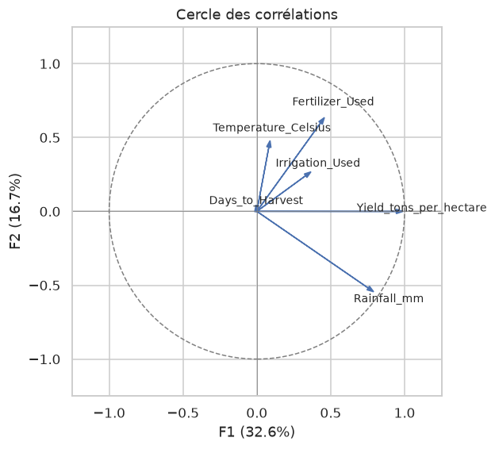
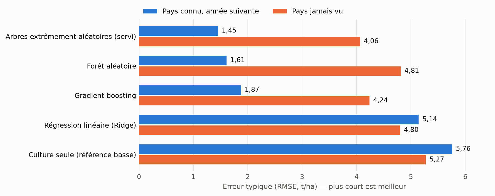
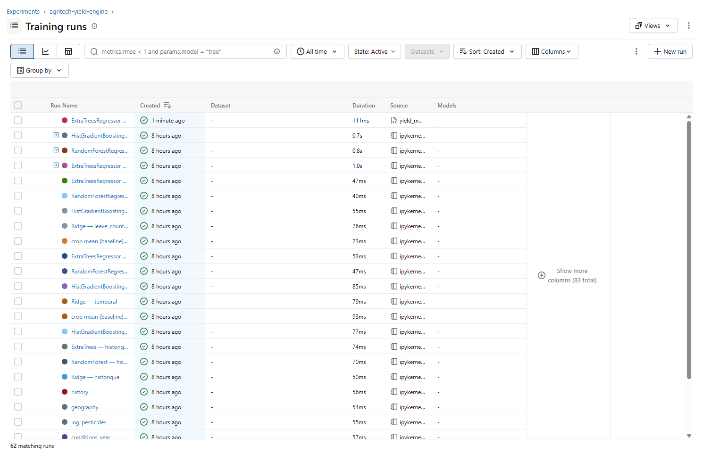
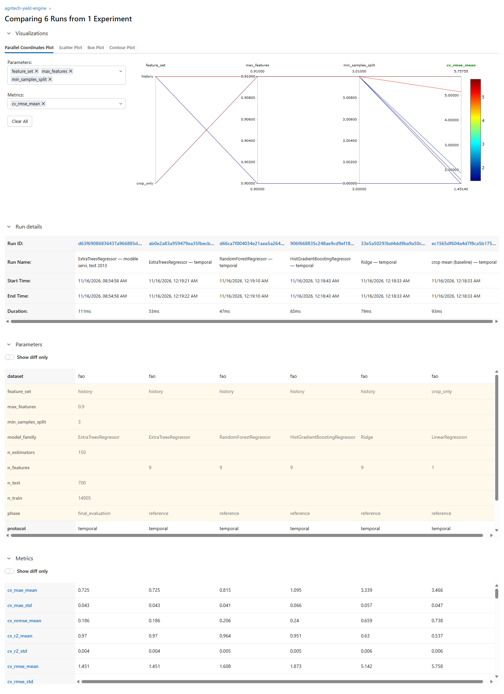
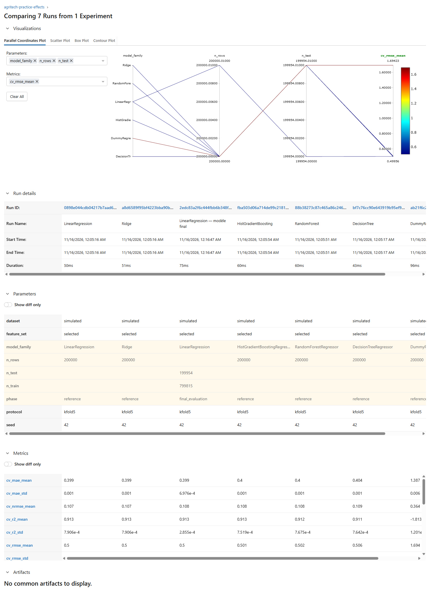
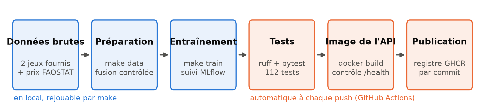

# Agritech Answers — rapport métier

*Un outil d'aide au choix des cultures : ce qu'il fait, ce qu'il a appris des données, ce
qu'il recommande, et ce qu'il ne sait pas.*

## 1. L'essentiel

L'application répond à deux questions d'un agriculteur, dans une même interface :

- **« Quel rendement puis-je attendre de cette culture ? »** — il choisit son pays, une
  culture, ajuste la température, la pluie et l'usage de pesticides, et obtient une
  estimation en tonnes par hectare, avec une fourchette.
- **« Quelle culture privilégier ? »** — avec les mêmes conditions, l'application estime le
  rendement de chaque culture et affiche le classement, par rendement ou par produit brut.

**Les deux réponses viennent du même modèle** : la culture en tête du classement a
exactement le rendement que l'écran de prédiction lui donne.

| Ce qu'il faut retenir | Chiffre |
|---|---|
| Pays couverts | 117, données de 1990 à 2013 |
| Cultures estimées et classées | maïs, blé, riz, soja |
| La meilleure culture est bien placée en tête | 92 fois sur 100 |
| Suivre le classement plutôt que le meilleur choix possible coûte | 1,7 % du produit brut |
| Fourchette d'une estimation | environ −35 % à +50 % autour du chiffre, selon la culture, dans 95 % des cas |
| Effet de l'engrais, de l'irrigation (parcelles simulées) | +1,50 t/ha, +1,20 t/ha |

> L'outil donne un **ordre de grandeur à l'échelle d'un pays**, pas une prévision pour une
> parcelle. Il est fiable pour comparer des cultures entre elles ; il l'est moins pour
> annoncer un tonnage précis.

## 2. Les données, et ce que nous en avons fait

Deux jeux de données nous ont été confiés. Ils sont de natures opposées, et c'est le
résultat le plus important de l'analyse.

| | Parcelles simulées | Données historiques (FAO) |
|---|---|---|
| Contenu | 1 000 000 de parcelles, générées par un simulateur | rendements réels par pays, année et culture |
| Ce qu'il sait | l'effet de l'engrais, de l'irrigation, de la pluie | l'écart réel entre les cultures |
| Ce qu'il ignore | **la culture n'y change rien** au rendement | les pratiques de l'agriculteur |

Dans le jeu simulé, les six cultures donnent le même rendement à 0,03 t/ha près, quelles
que soient les conditions. On ne peut donc pas s'en servir pour choisir une culture. Les
données historiques montrent à l'inverse un écart de 1 à 13 entre cultures.

**Trois décisions ont suivi.**

1. **Nous avons reconstruit les données historiques.** Le fichier déjà assemblé qui nous
   était fourni avait perdu de grands pays agricoles — États-Unis, Chine, Russie, Turquie —
   simplement parce que leur nom n'était pas écrit de la même façon d'une source à l'autre,
   et plus de la moitié de ses lignes étaient des doublons. En rapprochant les pays par leur
   code international et en contrôlant chaque assemblage, nous obtenons 117 pays complets,
   contre 101, sans aucun doublon.
2. **Nous avons fusionné les deux jeux par la culture**, seul point commun entre eux. Le
   dataset obtenu (un million de parcelles, chacune portant le profil mondial de sa culture)
   a surtout servi à trancher : il a prouvé que le rendement simulé ne dépend pas de la
   culture, et donc qu'il fallait apprendre le rendement par culture sur les données réelles.
3. **Nous avons ajouté une source de prix.** Le sujet demande la culture la plus rentable,
   et aucun des deux jeux ne contient de prix. Nous utilisons les prix payés aux producteurs
   publiés par la FAO, gratuits et officiels.

## 3. Les variables clés, expliquées

### Sur les parcelles simulées : quatre leviers, et rien d'autre

L'analyse en composantes principales demandée a un résultat net : **les variables du jeu
simulé sont indépendantes les unes des autres**. Chaque axe porte environ 20 % de
l'information, aucun ne résume les autres : il n'y a rien à simplifier. Un seul axe se
détache quand on y ajoute le rendement, et il réunit les quatre leviers ci-dessous.

{: width="330" }

| Levier | Effet mesuré sur le rendement |
|---|---|
| **Pluie** | le plus fort : +0,5 t/ha pour 100 mm de plus |
| **Engrais** | **+1,50 t/ha** quand il est utilisé |
| **Irrigation** | **+1,20 t/ha** quand la parcelle est irriguée |
| **Température** | faible mais régulier : +0,2 t/ha pour 10 °C de plus |

Le type de sol, la région, la météo déclarée, la durée du cycle et la culture n'ont aucun
effet mesurable. Nous avons vérifié qu'il ne reste **rien d'autre à apprendre** : un modèle
très souple, chargé de prédire les erreurs de cette formule simple à partir de toutes les
informations disponibles, n'y parvient pas du tout. Ce qui reste est du hasard.

### Sur les données réelles : ce qui se confirme, et ce qui ne se confirme pas

Confrontés aux données historiques, ces leviers ne se retrouvent qu'en partie :

- **Les intrants se confirment.** Les pays qui utilisent le plus de pesticides — notre
  indicateur de l'intensité en intrants, donc de la fertilisation — ont de meilleurs
  rendements.
- **La pluie ne se confirme pas** entre pays. Les pays les plus secs ne récoltent pas moins :
  l'Égypte, presque sans pluie, produit du riz autour de 9 t/ha. C'est la signature de
  l'**irrigation**, que les données ne mesurent pas directement. Nous en tirons un
  indicateur : sous 300 mm de pluie par an, l'agriculture est irriguée.
- Dans les données réelles, **le pays, la culture et l'année** expliquent l'essentiel :
  le niveau d'équipement agricole et le progrès technique pèsent plus que le climat de
  l'année.

La hiérarchie « pluie, engrais, irrigation » est donc une propriété du jeu simulé. Nous la
présentons comme un ordre de grandeur plausible, pas comme une loi agronomique.

## 4. Le modèle et ses résultats

### Un modèle choisi par comparaison, pas par habitude

Cinq familles de modèles ont été évaluées dans les mêmes conditions, de deux façons :

- **pays connu, année suivante** — le modèle apprend sur le passé et doit prédire une année
  qu'il n'a jamais vue. C'est la situation réelle de l'outil ;
- **pays jamais vu** — le modèle doit estimer le rendement d'un pays dont il n'a aucun
  historique. C'est le test de ce que les conditions expliquent à elles seules.

{: width="500" }

Le modèle retenu, une forêt d'« arbres extrêmement aléatoires », est le meilleur sur chacune
des cinq années de validation. Nous aurions préféré un modèle plus léger, plus simple à
héberger : les mesures ne le permettent pas.

**Ce que ce graphique dit aussi, et qu'il faut entendre.** Pour un pays que le modèle
connaît, l'erreur typique est de 1,45 t/ha. Pour un pays qu'il n'a jamais vu, elle monte à
4,06 t/ha. Autrement dit, **l'outil s'appuie surtout sur l'historique du pays** ; les
conditions saisies ajustent l'estimation, elles ne la fondent pas. Elles apportent tout de
même une information réelle : en ne connaissant que la culture, l'erreur serait de 5,27 t/ha.

### Une évaluation qui ne se raconte pas d'histoires

- Le rendement d'un pays change très peu d'une année à l'autre. Une évaluation classique,
  qui mélange les années, aurait donné un résultat flatteur et faux : une erreur sous-estimée
  d'un tiers. Nous évaluons donc toujours en prédisant le futur à partir du passé.
- **L'année 2013 a été mise de côté dès le départ** et n'a servi à aucun choix. Elle n'a été
  utilisée qu'une fois, à la fin : l'erreur moyenne y est de 0,79 t/ha, pour des rendements
  allant de 1 à 40 t/ha selon les cultures.
- La recherche des meilleurs réglages a été menée de façon systématique (63 configurations
  tirées au hasard, pour les deux modèles). Aucune n'apporte un gain qui tienne d'une année
  à l'autre : les réglages retenus sont donc confirmés, et non simplement repris.

### La qualité du classement, mesurée directement

L'agriculteur ne lit pas une erreur moyenne : il lit un ordre. Nous avons donc mesuré le
classement lui-même, sur l'année 2013 et les quatre cultures proposées.

| Critère de classement | La meilleure culture est en tête | Coût moyen d'une erreur |
|---|---|---|
| Matière sèche | 92 % des cas | 1,0 % du rendement |
| Produit brut (USD/ha) | 90 % des cas | 1,7 % du produit brut |

Quand le modèle se trompe sur la première place, il propose une culture presque équivalente.

### Les expérimentations sont tracées

Chaque essai est enregistré dans un journal d'expérimentations (MLflow) avec les mêmes
informations — modèle, données, méthode d'évaluation — et les mêmes mesures, ce qui permet
de les comparer d'un coup d'œil, y compris entre les deux modèles.

{: width="500" }

{: width="500" }

{: width="500" }

## 5. Recommandations agronomiques

Ces recommandations viennent du modèle, interrogé pour les 117 pays dans leurs conditions
les plus récentes.

### Quelle culture privilégier, selon le climat

| Température moyenne du pays | En rendement, la culture le plus souvent en tête | En produit brut |
|---|---|---|
| Moins de 12 °C (36 pays) | **maïs** (25 pays), puis riz | riz (24), puis maïs (12) |
| De 12 à 20 °C (27 pays) | **riz** (15), puis maïs (10) | riz (18) |
| Plus de 20 °C (54 pays) | **riz** (31), puis maïs (14) et blé (9) | riz (34), puis maïs (13) |

- **Le riz et le maïs se partagent la première place** dans 103 pays sur 117 en rendement.
  Le maïs domine sous les climats frais, le riz dès que la température monte.
- **Le blé** arrive en tête dans 13 pays seulement, dont 9 au climat chaud.
- **Le soja** n'est presque jamais premier en rendement (1,7 t/ha de médiane) ; son prix
  élevé le fait remonter dans le classement économique.

### Rendement ou valeur : le critère change la réponse

| Culture | Rendement médian là où elle est cultivée | Produit brut médian |
|---|---|---|
| Riz | 4,3 t/ha | 1 659 USD/ha |
| Maïs | 3,9 t/ha | 967 USD/ha |
| Soja | 1,7 t/ha | 918 USD/ha |
| Blé | 2,8 t/ha | 842 USD/ha |

Le riz, mieux payé, prend la tête du classement économique dans 76 pays, contre 54 en
rendement. En France par exemple, le maïs est premier dans les deux classements (9,2 t/ha,
environ 2 280 USD/ha), mais le riz passe devant le blé en valeur alors qu'il rend moins.

### Les pratiques : deux leviers à la main de l'exploitant

Sur les parcelles simulées, **fertiliser ajoute 1,50 t/ha et irriguer 1,20 t/ha**, soit
environ un tiers et un quart du rendement moyen. Les données réelles vont dans le même sens
pour les intrants. Ce sont les deux décisions que l'agriculteur prend lui-même : l'outil les
affiche à côté de chaque estimation, à titre indicatif.

### Comment lire une recommandation

1. **Regarder les deux premières cultures ensemble.** L'écart entre la première et la
   deuxième est de 28 % en médiane, mais il peut être inférieur à l'incertitude.
2. **Se méfier d'une culture signalée « jamais cultivée dans le pays ».** C'est le cas de la
   première proposée dans un pays sur six. L'outil la signale : rien dans les données ne
   permet de vérifier ce conseil.
3. **Saisir ses propres prix.** Pour un pays sur deux, une variation de prix de 20 % suffit
   à changer la culture en tête. L'agriculteur connaît son prix de vente mieux qu'une
   médiane nationale.
4. **Rester près des conditions du pays.** L'outil avertit quand une valeur saisie est rare
   pour la culture : l'estimation devient alors moins sûre.

## 6. Ce que l'outil ne sait pas

- **Il travaille à l'échelle d'un pays.** La pluie est une moyenne nationale, les pesticides
  un tonnage national. Deux parcelles voisines aux sols différents recevront la même réponse.
- **Ses données s'arrêtent en 2013.** Une utilisation réelle demanderait des données à jour.
- **Le produit brut n'est pas une marge.** Les coûts de production — semences, engrais,
  main-d'œuvre, irrigation — sont inconnus. L'outil désigne la culture qui se vend le plus
  cher à l'hectare, pas la plus rentable.
- **L'orge et le coton ne sont ni estimés ni classés.** Ils figurent dans le jeu simulé mais
  pas dans les données historiques : toute réponse aurait été une copie d'une autre culture.
- **L'effet de l'engrais et de l'irrigation vient d'un simulateur.** Il n'est jamais
  additionné à l'estimation, qui repose sur des données réelles.
- **117 pays sont servis**, ceux pour lesquels toutes les informations sont connues.

## 7. Une chaîne automatisée et reproductible

{: width="520" }

- **Tout se rejoue par une commande.** Chaque phase — préparation des données,
  entraînement, tests — a sa commande (`make data`, `make train`, `make test`), et
  `make all` les enchaîne. Le hasard est fixé : deux exécutions donnent les mêmes résultats.
- **Chaque modification est contrôlée automatiquement.** À chaque envoi de code, le code est
  vérifié, les 112 tests sont joués, l'image de l'API est construite et démarrée pour
  vérifier qu'elle répond. Elle n'est publiée que si tout a réussi.
- **Des garde-fous arrêtent la chaîne en cas d'anomalie** : un assemblage de données qui
  créerait des doublons, une information du futur qui se glisserait dans l'apprentissage, ou
  un désaccord entre les deux écrans font échouer les contrôles.
- **En cas d'échec, l'équipe est prévenue** par e-mail et par un ticket qui pointe vers
  l'exécution fautive.
- **L'application est en deux parties** : une API qui porte le modèle, et une interface qui
  ne fait qu'afficher ce que l'API répond. L'une peut évoluer sans l'autre.
